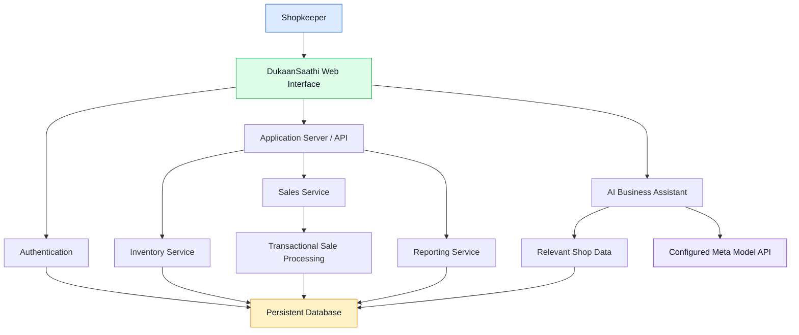
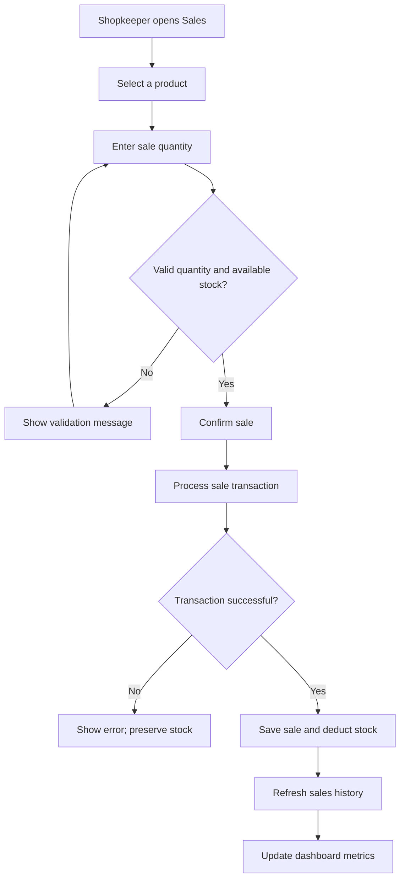
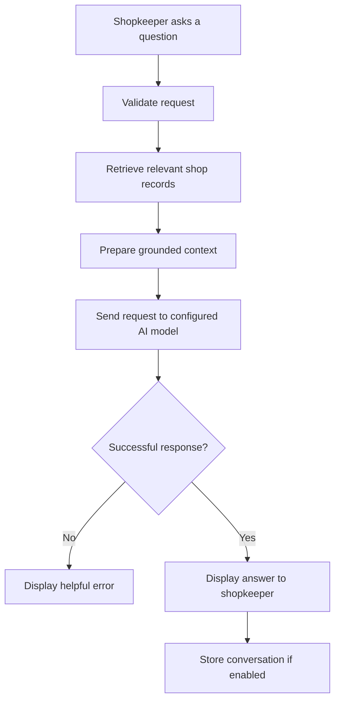
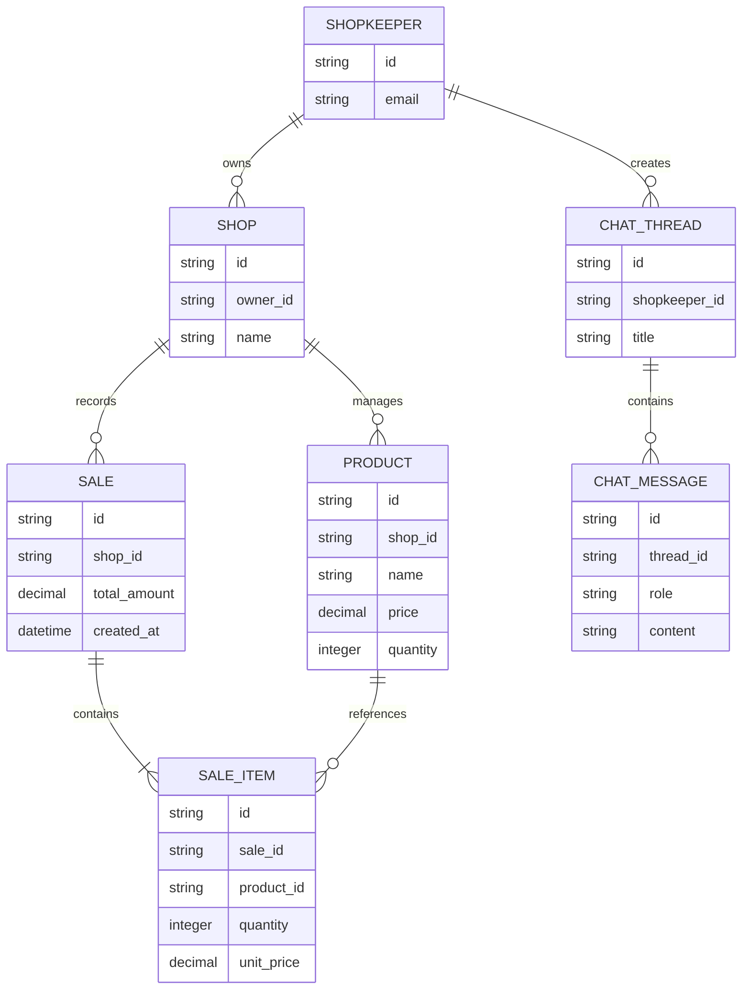

# 🛒 DukaanSaathi AI
### Smart Inventory Management & AI Business Assistant for Kirana Stores

<p align="center">
  <strong>Empowering neighborhood retailers with smarter inventory, sales tracking, and AI-assisted business insights.</strong>
</p>

<p align="center">
  <a href="https://dukaan-saathi-stock-sathi.lovable.app">🌐 Live Demo</a> ·
  <a href="https://github.com/Piyush-2006/dukaan-saathi-stock-sathi">💻 Source Code</a>
</p>

<p align="center">
  
  
  
</p>

---

## 📌 Table of Contents

- [Overview](#-overview)
- [Problem Statement](#-problem-statement)
- [Our Solution](#-our-solution)
- [Key Features](#-key-features)
- [Application Screenshots](#-application-screenshots)
- [System Architecture](#-system-architecture)
- [Application Workflow](#-application-workflow)
- [AI Business Assistant](#-ai-business-assistant)
- [Technology Stack](#-technology-stack)
- [Database Design](#-database-design)
- [Installation and Setup](#-installation-and-setup)
- [Environment Configuration](#-environment-configuration)
- [Testing](#-testing)
- [Security and Privacy](#-security-and-privacy)
- [Challenges and Solutions](#-challenges-and-solutions)
- [Future Roadmap](#-future-roadmap)
- [Contributing](#-contributing)
- [Author](#-author)
- [License](#-license)

---

## 🌟 Overview

**DukaanSaathi AI** is a digital shop-management platform designed to help small grocery stores and neighborhood kirana shops manage their daily operations more efficiently.

Many small retailers still rely on handwritten registers or disconnected spreadsheets to track products, sales, and stock levels. DukaanSaathi AI aims to simplify these activities through a centralized web application with inventory management, sales tracking, business reports, and an AI-assisted interface.

The project's long-term vision is to make useful digital business tools accessible to shopkeepers without requiring advanced technical knowledge.

🔗 **Live Application:** https://dukaan-saathi-stock-sathi.lovable.app

📦 **GitHub Repository:** https://github.com/Piyush-2006/dukaan-saathi-stock-sathi

> Project status: Under active development. Refer to the feature status and testing sections for the capabilities verified in the current version.

---

## 🎯 Problem Statement

Small neighborhood retailers face several operational challenges:

- **Manual inventory management:** Maintaining accurate stock records takes time.
- **Limited sales visibility:** Shopkeepers may struggle to understand daily revenue and sales trends.
- **Stock shortages:** Fast-moving products can run out before they are restocked.
- **Disconnected records:** Product information and sales history may be maintained separately.
- **Complex software:** Many business-management systems can be expensive or difficult for small retailers to adopt.
- **Limited business insights:** Shopkeepers may not have an easy way to interpret their business data.

### Our objective

Build a simple, accessible, and extensible shop-management system that combines reliable transaction records with understandable business insights.

---

## 💡 Our Solution

DukaanSaathi AI brings important shop operations into one interface.

The platform is designed around five core areas:

1. **Dashboard:** View important inventory and sales indicators.
2. **Products and Inventory:** Maintain product details, prices, and available quantities.
3. **Sales Management:** Record sales and keep stock quantities consistent.
4. **Reports and Analytics:** Understand revenue, transaction history, and inventory status.
5. **AI Business Assistant:** Explore shop data through natural-language questions, once the model integration is configured and verified.

The design prioritizes simplicity, clear status indicators, persistent records, and a responsive interface suitable for desktop and mobile screens.

---

## ✨ Key Features

### 📊 1. Business Dashboard

- Overview of products and stock levels.
- Daily sales and revenue indicators.
- Low-stock and out-of-stock visibility.
- Recent transaction summaries.
- Inventory valuation where supported by available product data.

### 📦 2. Product and Inventory Management

- Add and manage product records.
- Store product names, prices, and stock quantities.
- Adjust stock as inventory changes.
- Identify products requiring restocking.
- Validate product input to reduce invalid records.

### 💰 3. Sales Management

- Select products for a sale.
- Enter quantities and calculate the bill total.
- Validate available stock before completing a transaction.
- Record sales in persistent storage.
- Update inventory when a sale succeeds.
- Review sales history.

**Data integrity goal:** A sale and its corresponding stock deduction should succeed together or fail together. This prevents inventory records from becoming inconsistent.

### 📈 4. Reports and Analytics

The reporting module is intended to provide:

- Daily and historical sales summaries.
- Revenue trends.
- Product sales comparisons.
- Inventory status and restocking indicators.

Profit should only be calculated when reliable product cost information is available.

### 🤖 5. AI Business Assistant

The planned assistant will help shopkeepers ask questions such as:

- Which products are running low?
- What were today's recorded sales?
- Which products sold the most?
- Which items might need restocking?

The assistant should use actual application records as context, clearly identify missing information, and avoid inventing business figures.

**Meta AI integration status:** A working Meta model API integration must be verified before this feature is described as powered by a Meta model.

### 🔐 6. Authentication and Shop Profiles

The authentication-enabled version is intended to provide:

- Email-based sign-in.
- Shopkeeper profile information.
- Shop name and account context.
- Protected access to shop-management functions.
- Separation of data between shops.

Authentication and database permissions must be tested before the application is used with real business data.

---

## 🖼️ Application Screenshots

Add screenshots of your actual published application to the repository. Suggested folder structure:

```text
docs/
└── screenshots/
    ├── dashboard.png
    ├── inventory.png
    ├── sales.png
    ├── reports.png
    └── ai-assistant.png
```

After uploading the screenshots, display them in this section:

### Dashboard


### Inventory Management


### Sales Management


### Business Reports


### AI Business Assistant


> Replace these image paths with screenshots you have actually uploaded. Remove any screenshot section for a feature that is not yet available. The images will appear after the corresponding files are committed to GitHub.

---

## 🏗️ System Architecture

The following diagram illustrates the intended application architecture. Verify each connection against the actual implementation before treating this as the final deployed architecture.



### Architecture Components

| Component | Responsibility |
|---|---|
| Web interface | Dashboard, forms, tables, and chat |
| Authentication | Identity and access control |
| Application server | Validates and processes requests |
| Inventory service | Product and stock operations |
| Sales service | Sale validation and transaction processing |
| Database | Persistent application records |
| Reporting service | Aggregations and business metrics |
| Meta model integration | Natural-language assistance when configured |

---

## 🔄 Application Workflow

### Recording a sale



### AI assistant workflow



The AI workflow is a target design until the real model integration, data retrieval, and persistence have been tested.

---

## 🧰 Technology Stack

The repository currently contains files associated with a TypeScript-based TanStack application and database tooling. Confirm the exact versions and active dependencies in `package.json` before documenting them as the final stack.

| Technology | Intended role |
|---|---|
| TypeScript | Application logic and type checking |
| React | Component-based user interface |
| TanStack Start / Router | Application routing and server integration |
| Tailwind CSS | Interface styling, if enabled in the project |
| Drizzle ORM | Database schema and queries, where used |
| Supabase | Database and related backend services, where configured |
| Meta Model API | AI assistance, once genuinely integrated |
| GitHub | Source control and collaboration |
| Lovable | Application development and publishing workflow |

Only retain technologies that the current code actually uses.

---

## 🗃️ Database Design

The following is a conceptual data model for the application's intended functionality, not a claim that every table has already been implemented.



### Data integrity requirements

- Product quantities must not become negative.
- Sale quantities must be positive.
- Prices and totals must be validated.
- A sale and stock deduction should be transactional.
- Shop-specific data must be isolated by authorization rules.
- Chat history should be accessible only to authorized users.
- Database migrations should be version controlled.

---

## 🚀 Installation and Setup

### Prerequisites

Install the following tools:

- Node.js version supported by the project.
- npm.
- Git.
- A GitHub account.
- Access to the configured database and backend services.

### 1. Clone the repository

```bash
git clone https://github.com/Piyush-2006/dukaan-saathi-stock-sathi.git
cd dukaan-saathi-stock-sathi
```

### 2. Install dependencies

```bash
npm install
```

### 3. Configure environment variables

Create a local environment file based on the environment variable names actually referenced in the source code.

Do not copy production secrets into the repository.

See [Environment Configuration](#-environment-configuration).

### 4. Start the development server

Check the available scripts first:

```bash
npm run
```

Run the development command listed in `package.json`, commonly:

```bash
npm run dev
```

Use the local URL printed by the terminal.

### 5. Build for production

```bash
npm run build
```

Resolve all build errors before deploying changes.

> Important: The repository may rely on Lovable Cloud or remote database services. A successful local frontend build does not guarantee that authentication, database access, or the AI assistant works locally.

---

## 🔑 Environment Configuration

Use environment variables for configuration. The names below are examples only; match them to the actual application code and deployment setup.

```env
# Example placeholders — do not paste real secrets here
DATABASE_URL=your_database_connection_string
META_MODEL_API_KEY=your_server_side_meta_api_key
```

If the project uses Supabase, configure its actual URL, public client key, and any required server-only credentials according to the code and official service documentation.

**Never commit real API keys, passwords, database credentials, or service-role keys.**

For deployment, configure secrets in the hosting platform's secure environment settings.

---

## 🧪 Testing

Before releasing a version, verify the following:

### Inventory

- [ ] A product can be created with valid details.
- [ ] Invalid prices and quantities are rejected.
- [ ] Stock adjustments persist after refreshing the page.
- [ ] Low-stock indicators use the configured threshold.

### Sales

- [ ] A valid sale is recorded successfully.
- [ ] Insufficient stock prevents the sale.
- [ ] Stock decreases by the sold quantity.
- [ ] The sale appears in history.
- [ ] Revenue reflects the recorded transaction.
- [ ] Failed transactions do not partially deduct stock.

### Authentication and Data Isolation

- [ ] A user can sign in and sign out.
- [ ] Unauthorized users cannot access protected records.
- [ ] One shop cannot read or modify another shop's data.
- [ ] Session and password-reset flows behave as intended.

### AI Assistant

- [ ] A real configured Meta model API call succeeds.
- [ ] Responses use relevant, current shop data.
- [ ] Missing credentials and API failures are handled clearly.
- [ ] Responses do not invent sales figures.
- [ ] Threaded conversations persist and load for the correct user.
- [ ] The assistant cannot perform unauthorized stock modifications.

### Release

- [ ] The production build passes.
- [ ] The published URL works in a fresh browser session.
- [ ] No secrets are exposed in source files or browser requests.
- [ ] The README matches the released application.

Only mark tests complete after executing them.

---

## 🔒 Security and Privacy

Security is essential when handling shop inventory, transaction history, and business information.

The project should follow these principles:

- Keep privileged API keys on the server.
- Enforce authentication and authorization for protected operations.
- Apply database row-level security or equivalent access controls where supported.
- Validate all user input on the server.
- Avoid logging credentials or sensitive customer information.
- Restrict AI context to records the current user is authorized to access.
- Keep dependencies updated and review security advisories.
- Use HTTPS in production.
- Provide appropriate backups and recovery procedures before real-world use.

The current implementation must be audited and tested before these controls can be considered verified.

---

## 🧩 Challenges and Engineering Considerations

The project addresses several important engineering challenges:

**1. Maintaining inventory consistency**

Recording a sale and deducting stock must be handled safely, especially when multiple operations occur at the same time.

**2. Producing reliable business metrics**

Revenue and inventory figures should come from stored records rather than hard-coded demonstration values.

**3. Grounding AI responses**

The AI assistant must use actual database information and distinguish verified records from recommendations.

**4. Protecting shop data**

Authentication alone is not sufficient; each request must enforce authorization for the relevant shop and records.

**5. Supporting a simple user experience**

The interface should remain understandable to users who may not be familiar with complex business software.

---

## 🗺️ Future Roadmap

### Phase 1 — Core shop management
- [x] Publish a live application
- [x] Establish a GitHub repository
- [ ] Verify all inventory operations
- [ ] Verify end-to-end sale processing

### Phase 2 — AI assistance
- [ ] Integrate and test an eligible Meta model
- [ ] Ground responses in actual shop data
- [ ] Add robust error handling
- [ ] Verify threaded chat persistence

### Phase 3 — Account security
- [ ] Verify email authentication
- [ ] Enforce shop-level data isolation
- [ ] Review database access policies
- [ ] Add account recovery and session handling

### Phase 4 — Advanced retail features
- [ ] Customer Udhaar tracking
- [ ] Supplier and purchase management
- [ ] Restocking suggestions
- [ ] Exportable reports
- [ ] Optional voice interaction

### Phase 5 — Production readiness
- [ ] Automated testing
- [ ] Error monitoring
- [ ] Backup and recovery
- [ ] Performance and accessibility review
- [ ] Deployment security audit

---

## 🤝 Contributing

Contributions and suggestions are welcome.

1. Fork the repository.
2. Create a feature branch.
3. Make a focused change.
4. Run the available checks.
5. Open a pull request explaining the change.

For example:

```bash
git checkout -b feature/inventory-improvements
git add .
git commit -m "Improve inventory management"
git push origin feature/inventory-improvements
```

Do not include credentials or private business data in commits.

---

## 👨‍💻 Author

**Piyush Kumar**

Computer Science and Engineering student interested in software development, backend systems, and practical AI applications.

- GitHub: [@Piyush-2006](https://github.com/Piyush-2006)
- Project: [DukaanSaathi AI](https://dukaan-saathi-stock-sathi.lovable.app)

---

## 📄 License

No license has been specified yet. Choose and add an appropriate license file before allowing others to reuse or redistribute this project.

---

<p align="center">
  <strong>Built to make everyday shop management simpler, smarter, and more accessible.</strong>
</p>
